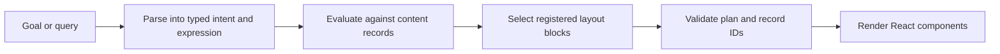

# Architecture

Vite builds a static React application. The browser loads local structured content and runs the full intent pipeline.

| Module | Responsibility |
| --- | --- |
| `src/data/content.ts` | Typed records for projects, experience, decisions, technologies, capabilities, dates, relationships, evidence status, and optional outcomes |
| `src/intent/` | Controlled vocabulary, phrase normalization, Boolean grammar, typed expression, and explicit resolution outcomes |
| `src/evaluation/evaluate.ts` | Three-valued matching against a supplied collection in source order |
| `src/planning/plan.ts` | Selection and validation of declarative block types and record IDs |
| `src/renderer/Renderer.tsx` | Closed React registry and reusable presentation of validated plans |
| `src/state/navigation.ts` | Shareable state and in-memory history restoration |
| `src/App.tsx` | Explicit navigation, form state, focus, and orchestration of the pipeline |
| `src/components/Inspector.tsx` | Display of the actual intermediate results and planned components |

## Intent grammar

A query uses a finite vocabulary with case-insensitive phrases and aliases, such as `back end`, `Postgres`, or `API development`. Criteria support content kind, category, technology, capability, context, and named entries. Phrases such as `career timeline` or `case study` request an arrangement. `NOT` precedes `AND`, which precedes `OR`. Adjacent criteria imply `AND`, and parentheses change the order. The parser recognizes `but not` and `excluding` as negation. Unknown terms, broken syntax, and competing layouts get explicit feedback. A broad query without an explicit content type uses the current goal as its scope. The finite vocabulary includes aliases for performance optimization, Scala, differential and regression testing, debugging, researcher feedback, and CI/CD without project-specific parser logic.

The evaluator treats absent optional attributes and unsupported runtime predicates as indeterminate, including under negation. An entry matches only when the overall expression is true. The plan carries known block types and record IDs. The renderer validates the plan before dispatch to the registry. Empty results produce an empty plan.

## URL contract

`view` records the resolved goal, `filter` contains allowlisted predicates and Boolean operators in postfix order, and `presentation` can identify a supported layout for that goal. Direct links and reloads rebuild the resolved intent from these fields and run it through evaluation and planning.

Typed text and clarification state live in document memory. History entries carry an opaque key so Back and Forward can restore that local state during the same page session. A reload retains canonical filters and clears the original text, unsubmitted draft, and local error or clarification state. If an older link includes `q`, the app interprets it locally and replaces the address with canonical parameters or the default view. The initial request for a legacy link may already contain the old query.

## Content and future integrations

Files under `src/data/` are public build inputs. The demonstration records are fictional. The portfolio's own architectural decision describes this implementation. Keep private source documents and evidence mapping outside the build graph and tracked files. Approved content can carry a publication-safe evidence reference.

Core features have no network-service dependency. A future contact service can be an optional client adapter calling a Pages Function without changing the intent or evaluation modules. Keep private credentials on the server.

## Theme preferences

Editorial Spectrum lives in CSS. The document exposes the selected preference and the effective light or dark scheme through root data attributes. A small script in the HTML head reads the manual choice before React mounts. System mode follows the browser's color-scheme media query through a native listener. OS changes update the root attributes without running the intent pipeline or re-rendering React.

Only the theme preference is stored. Choosing System removes the stored override. If storage is unavailable, manual choices work for the current document. The early script duplicates the storage key and initial selection rule to avoid waiting for the application bundle or a second asset. Tests exercise the actual bootstrap and the runtime behavior. The report-only CSP allows the bootstrap by its SHA-256 hash. See the [browser security checks](security.md) for build and deployment verification.

## Local career content review

Run `npm run dev -- --mode review` for an authorized local review. This mode
loads the ignored `.private/review.ts` overlay on loopback and labels results
that contain drafts. Standard development, builds (including builds in review
mode), and preview use the empty tracked overlay. The project, experience,
and four case-study records being prepared remain drafts. Keep source evidence
outside the application and prepare a separately approved content change for
release.
