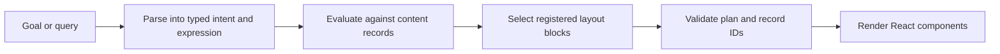

# Architecture

Vite builds a static React application. The browser loads local structured content and runs the full intent pipeline.

| Module | Responsibility |
| --- | --- |
| `src/data/content.ts` | Typed records for projects, experience, decisions, technologies, capabilities, dates, relationships, and evidence status |
| `src/intent/` | Controlled vocabulary, phrase normalization, Boolean grammar, typed expression, and explicit resolution outcomes |
| `src/evaluation/evaluate.ts` | Three-valued matching against a supplied collection in source order |
| `src/planning/plan.ts` | Selection and validation of declarative block types and record IDs |
| `src/renderer/Renderer.tsx` | Closed React registry and reusable presentation of validated plans |
| `src/state/navigation.ts` | Encoding and decoding shareable state |
| `src/App.tsx` | Explicit navigation, form state, focus, and orchestration of the pipeline |
| `src/components/Inspector.tsx` | Display of the actual intermediate results and planned components |

## Intent grammar

A query uses a finite vocabulary with case-insensitive phrases and aliases, such as `back end`, `Postgres`, or `API development`. Criteria support content kind, category, technology, capability, context, and named entries. Phrases such as `career timeline` or `case study` request an arrangement. `NOT` precedes `AND`, which precedes `OR`. Adjacent criteria imply `AND`, and parentheses change the order. The parser recognizes `but not` and `excluding` as negation. Unknown terms, broken syntax, and competing layouts get explicit feedback. A broad query without an explicit content type uses the current goal as its scope.

The evaluator treats absent optional attributes and unsupported runtime predicates as indeterminate, including under negation. An entry matches only when the overall expression is true. The plan carries known block types and record IDs. The renderer validates the plan before dispatch to the registry. Empty results produce an empty plan.

## URL contract

`view` records the selected goal. `q` records the committed query, and `layout` records a visitor's choice when the query admits more than one arrangement. The URL uses the root document for all views. Back and Forward restore the URL-driven state. Inspector visibility and an unsubmitted draft stay local to the current page. Query text is visible in a copied URL.

## Content and future integrations

Files under `src/data/` are public build inputs. The demonstration records are fictional. The portfolio's own architectural decision describes this implementation. Keep private source documents and evidence mapping outside the build graph and tracked files. Approved content can carry a publication-safe evidence reference.

Core features have no network-service dependency. A future contact service can be an optional client adapter calling a Pages Function without changing the intent or evaluation modules. Keep private credentials on the server.
